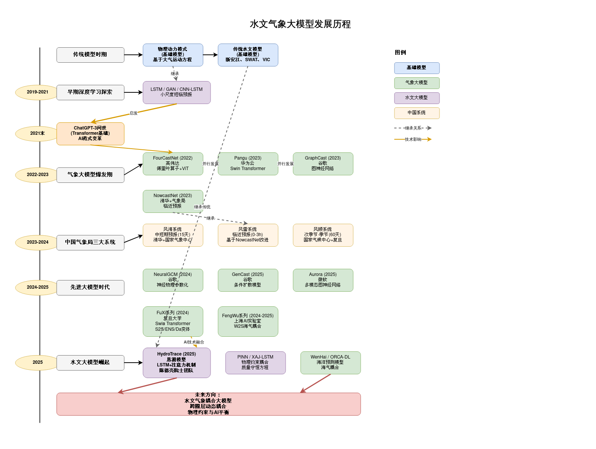

<!-- readme-visual-refresh:banner -->

<!-- /readme-visual-refresh:banner -->

# draw

<!-- readme-visual-refresh:artwork-source -->
[Editable banner artwork · Excalidraw](assets/readme/banner.excalidraw)
<!-- /readme-visual-refresh:artwork-source -->

<!-- readme-visual-refresh:execution -->
## Demonstration captured on EHPC · 17 October 2026

Original aiweather.drawio document rendered by the official diagrams.net viewer on EHPC. This is a drawing preview, not a scientific result; historical statements in the source drawing were not fact-checked.

[Execution record and checksums](assets/readme/execution-record.json).
<!-- /readme-visual-refresh:execution -->
